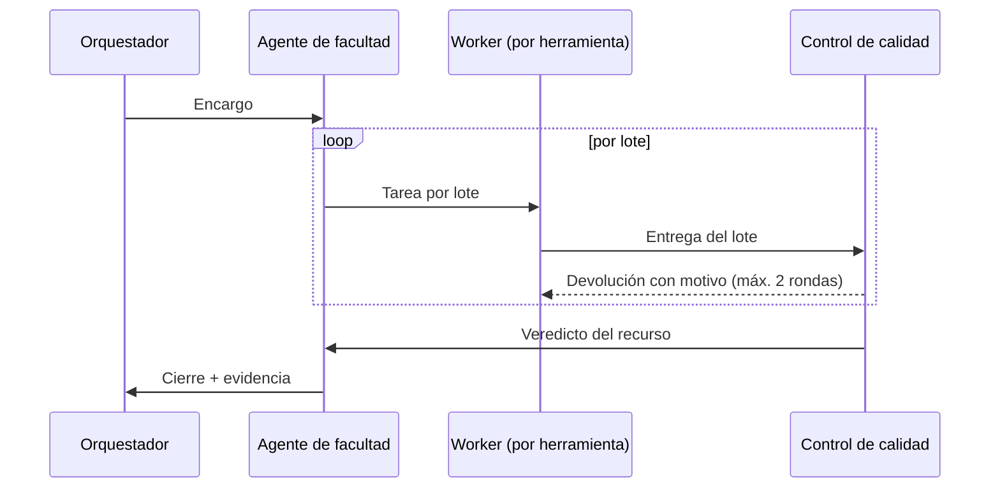

# Generador de Recursos de Estudio UTI — Especificación v1.3

> **Fecha:** 2026-10-27 · **Estado:** vigente; consolida lo implementado en P1, P2 y P4
> **Reemplaza a:** v1.2 (2026-10-19), v1.1 y v1.0 (2026-10-13). La v1.2 se conserva como historia.
> **Repositorio:** https://github.com/CZurita14/Agente-GenRecursos
> **Documentos de apoyo:**
> - [mapeo-silabo.md](mapeo-silabo.md): estructura del sílabo real y modelo de datos extraído.
> - [arquitectura-agentica-hive.md](arquitectura-agentica-hive.md): patrones multiagente tomados de Hive.
> - [analisis-astra-ai.md](analisis-astra-ai.md): referencia de producto.

### Decisiones cerradas en esta versión

| Tema | Decisión |
|---|---|
| Plataforma | **Backend propio** (Python/FastAPI) que reproduce los patrones de Hive, y **servidor MCP** para que PumaNet lo use desde su chat (Fase 2) |
| Organización de agentes | **Un agente coordinador por facultad + workers compartidos** por tipo de herramienta |
| Interacción del docente | **Menú de clases** como vía principal **+ chat de ajustes** con el agente de su facultad |
| Fuente de contenido | **Solo el sílabo** (decisión del 2026-10-20): no se solicitan ni se usan documentos de carrera para generar. El sílabo ya trae la competencia del perfil de egreso, los RA, el problema del territorio, los contenidos por clase y las rúbricas |
| Modelo de IA | **Qwen3-8B-AWQ en vLLM** del servidor privado de la universidad (§5). **No se cambiará por uno mayor** (decisión del 2026-10-20): la calidad se sostiene con el diseño del generador ([prueba-calidad-silabo.md](prueba-calidad-silabo.md)) |
| Cola de trabajos | **Sobre PostgreSQL** con leases (`SELECT … FOR UPDATE SKIP LOCKED`); sin servicios extra (§3.6) |
| Orquestación de agentes | **Código propio ligero** en Python + Pydantic con los patrones de Hive; sin LangGraph ni PydanticAI (§3.6) |
| Workers | **Compartidos por herramienta**, no por carrera; la carrera viaja como dato en mensajes tipados (§3.7), con reglas de aislamiento entre asignaturas (§3.8) |
| Aviso al docente | **Consulta periódica** del estado desde la pantalla (§3.6) |
| Base de conocimiento | Se conserva **solo el catálogo** de facultades y carreras; lo demás se retiró (§4.3) |
| Formato de las herramientas | Lo define una **plantilla que entregará el área académica**; el catálogo propuesto está en [catalogo-herramientas.md](catalogo-herramientas.md) |
| Llamadas a herramientas | **No se usan**: todo con salida JSON de esquema cerrado (el servidor no tiene activado el parser de herramientas) |
| Acceso | **Desde cualquier red, con inicio de sesión obligatorio** por código enviado al correo; **siempre** solo correos **@indoamerica.edu.ec** y **@uti.edu.ec**; Microsoft se vinculará más adelante (§2.1) |
| Revisor de IA | **Siempre activo** |
| Entrega en Canvas | **Exportación de archivos** en Fase 1; QTI en Fase 2 |
| Unidad de generación | **La clase (sesión)**, en un menú por semana y día |

### Cambios de la v1.3 (decisión D5, antes del P3)

Esta versión incorpora los hallazgos H1–H8 de la
[hoja de ruta](superpowers/plans/2026-10-26-analisis-y-hoja-de-ruta-fase1.md) §4
y los contratos que ya están implementados y probados. Donde el texto de abajo
y esta tabla difieran, manda esta tabla.

| # | Tema | Antes (v1.2) | Ahora (v1.3) | Sección | Origen |
|---|---|---|---|---|---|
| C1 | Base de datos | SQLite en desarrollo | **PostgreSQL en todos los entornos**: la cola necesita `FOR UPDATE SKIP LOCKED` | §14 | H1, P1 |
| C2 | Identificador de asignatura | `{asig}` = código PF | **UUID** (`asignatura_id`). Una asignatura es única por dueño + código PF; el código y la versión viajan como datos | §11, §12 | H2, P1, P4 |
| C3 | Recorte del prompt | Primero «fragmentos de conocimiento» | Primero la **lista de ya generados**, después la **rúbrica** (por el final); **nunca la clase**. Conteo con `/tokenize` y búsqueda binaria | §5.3 | H3, P1 |
| C4 | Salida del revisor | Tope fijo de 3 500; revisor de a 3 ítems | `max_tokens = 8 192 − entrada − 300`. **Un ítem por llamada**, a ciegas (sin clave ni justificaciones); reintento si la salida se corta | §5.3, §10 | H4, P1 |
| C5 | Temperatura del revisor | 0 (por medir) | **Se mantiene 0**: cuatro corridas reales sin bucles de razonamiento | §5.2 | H5, T15 |
| C6 | Concurrencia | `LLM_MAX_CONCURRENCIA` «total» | Fase 1: **un** proceso `worker` con N hilos y un semáforo compartido. Con varios procesos, semáforo en PostgreSQL | §3, §5.4 | H6, P1 |
| C7 | Techo del RA | Sin tabla verbo → nivel | **Pendiente para el P3** con el área académica (Bloom en español) | §6.2.3 | H7 |
| C8 | Calidad de cuestionarios | Publicación normal | **Borrador obligatorio** para el docente hasta cumplir 14/16 ítems sólidos (`evidencia.borrador = true`) | §15, §16.1 | H8, P1 |
| C9 | Integridad académica | «Otros casos y datos» sin mecanismo | La **evidencia del momento** cuenta como entregable. El planificador asigna a cada ítem un **escenario** del perfil de la carrera y descarta los que comparten palabras clave con los entregables. El revisor devuelve solo si se entrega la solución o un borrador del entregable, no por practicar el mismo contenido | §9.4, §4 | T15, `docs/prueba-calidad-silabo.md` §6 |
| C10 | Lectura del sílabo | Por secciones | Segmentación **por posición** en la página. Se descartan **I, VII, el índice y el pie** «Generado por <usuario>» (también es dato personal). Las sesiones que empiezan al pie de página se reconstruyen. Error `SilaboIlegible` sin texto del PDF | §7 | P2 |
| C11 | Recepción del PDF | ≤ 50 MB, multipart | **Cuerpo binario `application/pdf`**, ≤ **10 MB** contados sobre los bytes reales, 30 s de recepción, lectura en **subproceso** (20 s, 512 MB, ≤ 60 páginas). El PDF no se persiste | §7, §12 | P2, P4 |
| C12 | Acceso | Código por correo | Código de **6 dígitos**, HMAC, **10 min**; **5 fallos → bloqueo de 15 min** (persistente, no se levanta al pedir otro código). Sesión **8 h** de inactividad / **7 días** absolutos, cookie HttpOnly/Secure/SameSite=Lax, revocable en servidor | §2.1, §14 | P4 A2 |
| C13 | Escrituras | — | Toda escritura exige `Origin` igual a `API_ORIGEN` (también el ingreso). JSON ≤ 1 MiB / 30 s | §14 | P4 A1, A4 |
| C14 | Ediciones | Ediciones del docente | `PUT` con **revisión optimista** (409 si cambió). Un cambio real deja el recurso en `requiere_revision`, conserva la evidencia original con `evidencia_vigente = false` y registra antes/después con `uso_mejora = false`. Guardar sin cambios no altera nada | §10.3, §12 | P4 A4 |
| C15 | Límites y bitácora | `429` por intentos | Cuotas persistentes por IP y por correo en ventanas UTC, seudonimizadas con HMAC, con `Retry-After`. Proxy confiable solo si se configura. Bitácora sin URL, cuerpos ni identidades en claro; retención técnica propuesta de 30 días | §14 | P4 A5 |
| C16 | Privacidad | — | Aviso en **borrador** (`docs/privacidad-borrador.md`), pendiente de aprobación institucional (B9). El aviso aprobado deberá poder leerse **antes** de pedir el correo | §2.1, §14 | P4 A5 |

**Rutas implementadas hoy** (P4): `/salud`, `/auth/*`, `/privacidad`,
`/silabos`, `/asignaturas`, `…/menu`, `…/herramientas`, `…/generar`,
`…/trabajos`, `…/recursos`, `…/recursos/{id}` (GET/PUT), `…/compartir` y
`/admin/consumo`. Pendientes: regenerar ítem y chat (P5), exportar (P6) y
tokens MCP (Fase 2). Nombres reales de la configuración:
[desarrollo-api.md](desarrollo-api.md).

---

## 1. Visión general

El docente sube el sílabo aprobado de su asignatura (proyecto formativo). El
sistema lo lee, lo asigna al **agente de su facultad** y presenta un **menú de
clases por semana y día**. Cuando el docente lo decide, elige una clase, un
momento o la asignatura completa, y el agente genera **herramientas de estudio
para los estudiantes**, de nivel universitario y alineadas con lo que el
sílabo planifica. El docente revisa, ajusta (por pantalla o conversando con el
agente) y exporta para Canvas.

**Principios:**

1. **Una sola entrada:** el sílabo, en su versión final; no se evalúa ni se
   modifica.
2. **La IA llena esquemas; el código dibuja:** la IA nunca escribe HTML ni
   JavaScript.
3. **Determinismo primero:** leer el sílabo, construir el menú, enrutar,
   planificar y verificar se hace con código. La IA solo genera, revisa e
   interpreta el chat.
4. **Apoyo, no sustitución:** ninguna herramienta resuelve una tarea, una
   PAE, una evaluación ni la evidencia de un momento (§9.4).
5. **Trazabilidad:** cada herramienta lleva su "paquete de evidencia" (de qué
   clase, RA y contenido sale; qué verificaciones pasó).

---

## 2. Acceso, usuarios y flujo

### 2.1 Acceso e inicio de sesión

- El aplicativo es **accesible desde cualquier red** (internet), por HTTPS.
- **Inicio de sesión obligatorio** para todo, salvo la pantalla de ingreso.
- **Dominios permitidos:** solo correos que terminen exactamente en
  `@indoamerica.edu.ec` o `@uti.edu.ec`. La lista va en configuración
  (`DOMINIOS_PERMITIDOS`) para poder ampliarla sin tocar código.
- **Verificación de propiedad del correo:** no basta con escribir un correo
  del dominio; hay que demostrar que es propio. Mecanismo por defecto:
  **código de un solo uso** enviado a ese correo (6 dígitos, válido 10
  minutos, máximo 5 intentos). No se guardan contraseñas.
- **Microsoft no se vincula por ahora** (decisión del 2026-10-19). El módulo
  de autenticación queda aislado para poder añadir más adelante el inicio de
  sesión con Microsoft Entra ID sin cambiar el resto.
- **Regla permanente:** cualquiera que sea el mecanismo (código por correo
  hoy, Microsoft en el futuro), **solo se admiten correos de los dominios
  permitidos**. Un proveedor externo nunca reemplaza esa validación: se
  comprueba también el dominio del correo que devuelva.
- **Validación del dominio:** se toma la parte después del último `@`, en
  minúsculas, y se compara por **igualdad exacta** con la lista. Se rechazan
  subdominios y variantes (`x@indoamerica.edu.ec.otro.com`,
  `x@mail.indoamerica.edu.ec`).
- **Sesión:** cookie `HttpOnly`, `Secure`, `SameSite=Lax`, vigencia de 8 horas
  de inactividad y 7 días como máximo; cerrar sesión la invalida en el
  servidor.
- **Propiedad de las asignaturas:** cada asignatura pertenece al docente que
  subió el sílabo. Solo él la ve y la edita. Puede **compartirla** con otro
  correo de los dominios permitidos (por ejemplo, un coordinador o un docente
  del mismo proyecto formativo) como editor o como lector.
- **Mis asignaturas:** al entrar, el docente ve sus asignaturas y las
  compartidas con él.
- Si dos docentes suben el mismo sílabo (mismo código de proyecto formativo),
  cada uno tiene **su propia asignatura**: la clave es dueño + código.
- **Roles:** `docente` (por defecto) y `administrador` (consumo de IA, alta
  de agentes de facultad), asignado por configuración.

### 2.2 Flujo

```text
0. Iniciar sesión → 1. Subir sílabo → 2. Menú de clases → 3. Elegir clase y → 4. Cola de  → 5. Revisar, ajustar → 6. Exportar
   (correo del        (PDF)            por semana y día     herramientas        generación    (pantalla o chat)     (HTML/PDF/DOCX)
   dominio + código)                   + agente asignado                        con aviso
```

Subir una versión nueva del mismo sílabo (mismo código de proyecto formativo)
actualiza el menú y marca las clases cuyo contenido cambió.

---

## 3. Arquitectura multiagente

### 3.1 Vista general

```text
                      ┌──────────────────────────────────────────────┐
  PDF del sílabo ───► │ LECTOR (determinista) → SilaboUTI             │
                      └──────────────────────┬───────────────────────┘
                                             ▼
                      ┌──────────────────────────────────────────────┐
                      │ ORQUESTADOR (determinista)                    │
                      │  · enruta por "Facultad" al agente que toca   │
                      │  · construye el menú de clases                │
                      │  · encola y despacha trabajos                 │
                      └───┬──────────────┬──────────────┬────────────┘
                          ▼              ▼              ▼
              ┌────────────────┐ ┌────────────────┐ ┌────────────────┐
              │ Agente         │ │ Agente         │ │ Agente general │  coordinador
              │ Ingenierías    │ │ <facultad N>   │ │ (sin catálogo) │  por facultad
              └───────┬────────┘ └───────┬────────┘ └───────┬────────┘
                      └──────────────────┼──────────────────┘
                                         ▼  tareas (con contexto de la facultad)
   ┌──────────────────────────────────────────────────────────────────────────┐
   │ WORKERS COMPARTIDOS  ficha · práctica · cuestionario · tarjetas · repaso ·  │
   │                      caso · simulacro · autoevaluación · guía de evidencia │
   └──────────────────────────────────┬───────────────────────────────────────┘
                                      ▼
   ┌──────────────────────────────────────────────────────────────────────────┐
   │ VERIFICACIÓN DETERMINISTA → REVISOR (IA, siempre) → cierre del coordinador │
   │   no cumple → devolución al worker con feedback (máx. 2 rondas)            │
   └──────────────────────────────────┬───────────────────────────────────────┘
                                      ▼
                     Recurso + paquete de evidencia → docente
   Transversal: cola persistente · registro de uso · memoria de ediciones del docente
```

### 3.2 Roles

| Rol | Tipo | Responsabilidad | Usa IA |
|---|---|---|---|
| **Lector** | Componente | PDF → `SilaboUTI` ([mapeo-silabo.md](mapeo-silabo.md)) | No (respaldo con IA solo para plantillas no reconocidas) |
| **Orquestador** | Componente | Enrutar por facultad, construir el menú, encolar y despachar, aplicar presupuestos | No |
| **Agente de facultad** (coordinador) | Agente | Recibir la petición (menú o chat), armar el plan de trabajo con el planificador, aplicar el estilo de la facultad, juzgar el cierre y pedir correcciones | Solo para interpretar el chat y para el cierre cuando el revisor deja dudas |
| **Planificador** | Componente | Tabla de especificaciones (RA × nivel), asignación de contenidos, lotes que caben en el contexto del modelo | No |
| **Workers** (uno por herramienta) | Agentes | Generar su herramienta llenando su esquema, lote por lote | Sí |
| **Verificador** | Componente | Comprobaciones deterministas (§10.1) | No |
| **Revisor** | Agente | Resolver ítems sin ver la clave, detectar ambigüedad y detectar que una herramienta resuelva un entregable (§10.2) | Sí, con modo razonamiento |

Patrón tomado de Hive: el coordinador **delega**, cada entrega pasa por
**verificación determinista** y el coordinador juzga solo lo que la
verificación no cubre; si no cumple, devuelve la tarea **con feedback
concreto** al mismo worker (equivalente a `task_revise`).

### 3.3 Ciclo de una generación

```text
Docente pulsa [Generar] en "Clase 3 · mié 14/10" con {cuestionario, ficha}
  1. Orquestador crea un Trabajo (job) por herramienta → cola persistente
  2. Agente Ingenierías arma el contexto: clase + momento + RA + rúbrica
     + política de IA + estilo de la facultad (≤ presupuesto, §5.3)
  3. Planificador: tabla de especificaciones y lotes (p. ej. 12 ítems → 3 lotes de 4)
  4. Worker "cuestionario" genera lote a lote (JSON con esquema)
  5. Verificador: esquema, claves, distribución, duplicados, trazabilidad
        └─ falla → reintento del lote con el error concreto (máx. 2)
  6. Revisor: resuelve cada ítem a ciegas; revisa integridad académica
        └─ discrepancia → el ítem vuelve al worker con el motivo (máx. 2 rondas);
           si persiste → se entrega marcado "requiere revisión"
  7. Coordinador cierra: arma el Recurso y su paquete de evidencia
  8. El menú cambia a "Generada" y el docente recibe el aviso en pantalla
```

### 3.4 Acciones del agente sin llamadas a herramientas

El servidor de IA no tiene activadas las llamadas a herramientas. Cuando un
agente debe **elegir qué hacer** (por ejemplo, interpretar un mensaje del chat),
responde con un JSON de esquema cerrado y el código ejecuta la acción:

```jsonc
// AccionAgente — salida forzada por esquema
{
  "accion": "ajustar_recurso",          // ajustar_recurso | generar | aclarar | fuera_de_alcance
  "recurso_id": "rec_…",                // si aplica
  "ambito": { "tipo": "clase", "id": "M2-S1" },
  "herramientas": ["cuestionario"],
  "cambios": { "dificultad": "subir", "contexto": "empresa de Ambato", "items": ["i3", "i7"] },
  "mensaje_al_docente": "Subo la dificultad de las preguntas 3 y 7 y las contextualizo en una empresa de Ambato."
}
```

El código valida que los IDs existan en la asignatura antes de ejecutar nada.

### 3.5 Servidor MCP (Fase 2)

El backend expone sus capacidades como servidor MCP para que PumaNet u otro
cliente las use desde su chat: `obtener_menu`, `generar`, `estado_trabajo`,
`obtener_recurso`, `exportar`. Todas exigen un **token personal de API** que
el docente genera desde su cuenta (revocable) y actúan con sus permisos.

### 3.6 Implementación (decidida el 2026-10-20)

**Procesos:**

| Proceso | Qué hace | Escala |
|---|---|---|
| `web` | Frontend React compilado, servido por nginx | 1 |
| `api` | FastAPI: ingreso, asignaturas, lector del sílabo, menú, encolado, chat, exportación | 1 o más |
| `worker` | Consume la cola y ejecuta el flujo multiagente (§3.3) | 1 o más; el total de llamadas simultáneas al modelo lo limita `LLM_MAX_CONCURRENCIA` |
| `db` | PostgreSQL 18 (datos de la aplicación, cola y catálogo) | 1 |
| `proxy` | nginx con HTTPS, publicado a internet; único punto de entrada | 1 |

Todos en un `docker-compose` desplegado dentro de la red universitaria (el
servidor de IA solo es alcanzable desde allí, §5.1).

**Cola sobre PostgreSQL** (patrón `DurableLaneQueue` de Hive):

- Tabla `trabajo` (§11): el worker toma el siguiente con
  `SELECT … FOR UPDATE SKIP LOCKED`, marca `lease_hasta` y lo renueva mientras
  trabaja.
- Si un worker cae, el lease vence y otro worker retoma el trabajo desde su
  último lote guardado.
- Un "carril" por asignatura: dos trabajos de la misma asignatura no se
  ejecutan a la vez, para no competir por el contexto ni duplicar ítems.
- Si el servidor de IA no responde, el trabajo pasa a `en_espera` y se
  reintenta con espera creciente.

**Orquestación con código propio:**

- Cada rol de §3.2 es una clase de Python con entradas y salidas tipadas con
  Pydantic; el coordinador las encadena según §3.3.
- Un solo cliente de IA (`llm/`) aplica a todas las llamadas el presupuesto de
  tokens (§5.3), la penalización de repetición, los reintentos y el registro
  de uso.
- Sin LangGraph ni PydanticAI: el modelo no tiene tool calls y el flujo es
  fijo, así que un framework no aporta y oculta lo que hay que probar.
- Cada rol se prueba por separado con un cliente de IA simulado.

**Aviso al docente:** la pantalla consulta `/asignaturas/{asig}/trabajos`
cada 3 segundos mientras haya trabajos activos, y muestra el avance por lotes
("generando 2 de 6", "revisando").

**Estructura del repositorio:**

```text
Agente-GenRecursos/
├── backend/
│   ├── app/
│   │   ├── api/            rutas: auth, asignaturas, generar, recursos, chat, admin
│   │   ├── auth/           códigos de ingreso, sesiones, regla de dominios
│   │   ├── silabo/         lector PDF, SilaboUTI, menú, detección de cambios
│   │   ├── agentes/        orquestador, coordinador, planificador, verificador, revisor, cálculo
│   │   │   └── workers/    un worker por herramienta
│   │   ├── herramientas/   esquemas Pydantic y renderizado HTML/PDF/DOCX
│   │   ├── llm/            cliente vLLM: presupuesto, reintentos, penalización, uso
│   │   ├── cola/           trabajos con lease sobre PostgreSQL
│   │   └── db/             modelos y migraciones
│   ├── worker.py           proceso que consume la cola
│   └── tests/
├── frontend/               React + Vite + Tailwind
├── agentes/                perfil de cada facultad (YAML) y glosarios
├── kb/                     catálogo de facultades y carreras
├── pruebas/                pruebas de calidad (§16.1)
├── infra/                  docker-compose y nginx
└── docs/
```

### 3.7 Mensajes entre agentes

Los workers son **compartidos por herramienta** (decisión del 2026-10-20): no
hay workers por carrera; la carrera viaja como dato en cada mensaje. Los
agentes no conversan libremente: cada flecha es un **mensaje tipado**
(Pydantic, inmutable) que se guarda en PostgreSQL con el `trabajo_id`, de
modo que cada paso queda trazado y un trabajo se puede retomar tras una caída.



| Mensaje | De → a | Contenido |
|---|---|---|
| `Encargo` | Orquestador → agente de facultad | `trabajo_id`, asignatura (código PF y versión del sílabo), carrera y nivel, ámbito (clase, momento o asignatura), herramientas, perfil de dificultad, instrucciones del docente |
| `TareaLote` | Agente → worker | `trabajo_id`, `asignatura_id`, `clase_id`, contexto de la clase tomado del sílabo, estilo de la facultad, plan del lote (focos y niveles), lo ya generado **para esa misma clase**, resultados calculados si aplica |
| `EntregaLote` | Worker → control de calidad | `trabajo_id`, ítems o secciones en el esquema de la herramienta |
| `Devolucion` | Control de calidad → worker | `trabajo_id`, ítem, motivo concreto, ronda |
| `Veredicto` | Control de calidad → agente | `trabajo_id`, resultado de la verificación y del revisor por ítem |
| `Cierre` | Agente → orquestador | `trabajo_id`, recurso y paquete de evidencia (§10.3), tokens |

Uso de IA por paso: el orquestador **no** usa IA; el agente de facultad solo
la usa para interpretar el chat; workers y revisor sí. Las herramientas sin
IA (hoja de ruta, autoevaluaciones, listas de verificación) las arma el
código sin pasar por workers ni revisor.

### 3.8 Aislamiento entre asignaturas

Varios docentes pueden generar al mismo tiempo con los mismos workers. El
modelo no mezcla materias por sí mismo (no guarda memoria entre llamadas y
vLLM procesa cada petición con su propio contexto), así que el riesgo está en
**lo que el código pone en cada prompt**. Reglas obligatorias:

| # | Regla | Dónde se aplica |
|---|---|---|
| A1 | **Trabajo autocontenido:** todo mensaje lleva `trabajo_id`, `asignatura_id` y versión del sílabo; el contexto se arma solo con filas de la base filtradas por esos identificadores | `cola/`, `agentes/` |
| A2 | **Workers sin estado:** ninguna variable global ni caché en memoria con contenido de una asignatura; cada tarea crea su propio contexto y los mensajes son inmutables | `agentes/workers/` |
| A3 | **Un solo constructor de prompts** (`llm/`): recibe el contexto ya filtrado y encabeza cada prompt con el sello de la asignatura (código PF, clase y fecha); ningún worker arma prompts por su cuenta | `llm/` |
| A4 | **"Lo ya generado" por clase:** la lista que evita repeticiones se consulta por `asignatura_id` + `clase_id`, nunca global | `agentes/planificador` |
| A5 | **Chat por asignatura y usuario:** el historial del chat de ajustes se guarda y se carga por `asignatura_id` + `usuario_id`; nunca se comparte | `api/chat`, `agentes/facultad` |
| A6 | **Carril por asignatura** en la cola: dos trabajos de la misma asignatura no corren a la vez (§3.6) | `cola/` |
| A7 | **Verificación de pertenencia:** cada ítem entregado debe citar una clase, RA y contenido que existan en **esa** asignatura (§10.1, regla 3); el `asignatura_id` de la entrega debe coincidir con el del trabajo; si no, se descarta | `agentes/verificador` |
| A8 | **Trazabilidad por llamada:** cada llamada al modelo se registra con `trabajo_id` y `asignatura_id` para auditar cualquier mezcla | `llm/` |
| A9 | **Permisos:** un docente solo encola trabajos y lee recursos de asignaturas propias o compartidas con él (§2.1) | `api/` |

**Prueba obligatoria (criterio de aceptación 14):** dos docentes generan al
mismo tiempo para dos asignaturas distintas (por ejemplo, Análisis de Datos y
TIC); ningún ítem, ficha, mensaje ni registro de una contiene referencias a
la otra.

---

## 4. Agentes de facultad

### 4.1 Qué es un agente de facultad

Una **configuración** (`agentes/<facultad>.yaml`) con el estilo de su área.
No es otra aplicación: comparte el núcleo, los workers y la verificación. El
contenido siempre sale del sílabo (§4.2).

```yaml
# agentes/ingenierias.yaml
id: ingenierias
facultad: FING                                     # sigla en kb/catalogo.yaml
estilo:
  tipos_de_caso: [datasets, código, arquitectura de sistemas, incidentes de seguridad]
  software_habitual: [JASP, Numiqo, Git, Visual Studio Code, Canvas]
  vocabulario: agentes/glosarios/ingenierias.md
herramientas_recomendadas:
  clase: [practica_guiada, cuestionario, ficha_clase, tarjetas]
  momento: [simulacro, estudio_caso, autoevaluacion_rubrica, repaso_momento, guia_evidencia]
```

### 4.2 Fuentes de conocimiento

**Regla:** el contenido de las herramientas sale **solo del sílabo**. No se
piden ni se usan documentos de carrera (proyectos, mallas, perfiles) para
generar.

| Fuente | Contenido | Uso en el prompt |
|---|---|---|
| Sílabo de la asignatura | Competencia del perfil de egreso, RA y evidencias, problema del territorio, PIS, producto final, momentos, clases (contenidos y actividades), rúbricas, recursos y política de IA | Siempre; es la única fuente de contenido |
| Configuración de la facultad (`agentes/<facultad>.yaml`) | Vocabulario, tipos de caso y software habituales del área | Orientar el estilo de los casos y ejemplos; nunca aporta contenidos nuevos |

La base de conocimiento de carreras construida el 2026-10-20 se **retiró**
el mismo día ([base-conocimiento-carreras.md](base-conocimiento-carreras.md);
código archivado en `kb/archivo/`). Solo se conserva su catálogo de
facultades y carreras, que se usa para enrutar cada sílabo al agente de su
facultad (§4.3).

### 4.3 Catálogo de facultades

El catálogo completo de facultades y carreras (8 facultades, definido por el
usuario el 2026-10-20) está en `kb/catalogo.yaml` y en la tabla `facultad` /
`carrera`, con los nombres alternos que aparecen en los sílabos. Cada
facultad del catálogo tiene su agente.

Facultad no reconocida → **agente general** (sin conocimiento de carrera) y
aviso para darla de alta.

### 4.4 Memoria de la facultad (Fase 2)

Inspirada en el ciclo ACE de Hive: las ediciones que los docentes hacen a los
ítems generados ("subió la dificultad", "cambió el caso", "eliminó una
pregunta de memoria") se registran y se resumen en **reglas por facultad**
que se inyectan en los siguientes prompts. Las reglas llevan contadores de
utilidad y se desactivan si empeoran los resultados.

---

## 5. Modelo de IA

### 5.1 Servidor

| Dato | Valor (comprobado el 2026-10-19) |
|---|---|
| Modelo | `Qwen/Qwen3-8B-AWQ` (8B parámetros, cuantizado a 4 bits) |
| Servidor | vLLM, API compatible con OpenAI, en la red universitaria (`http://172.16.8.69:8000/v1`) |
| Contexto máximo | **8 192 tokens** (entrada + salida) |
| Salida JSON con esquema (`response_format: json_schema`) | **Funciona** |
| Llamadas a herramientas | No activadas |
| Velocidad observada | ~30 tokens/s por petición |
| Modo razonamiento | Se activa por petición (`chat_template_kwargs.enable_thinking`) |

La URL y el modelo van en configuración (`LLM_BASE_URL`, `LLM_MODEL`), nunca
en el código. El servidor no pide clave.

**Consecuencia para el despliegue:** el servidor de IA solo es alcanzable
dentro de la red universitaria, pero el aplicativo se usa desde cualquier red.
Por eso el **backend se despliega dentro de la red universitaria** y se publica
a internet mediante un proxy inverso con HTTPS. El servidor de IA **nunca** se
expone a internet: solo el backend habla con él.

### 5.2 Uso por rol

| Rol | Razonamiento | Temperatura | Salida |
|---|---|---|---|
| Workers | No | 0,4 | JSON del esquema de la herramienta |
| Revisor | **Sí** | 0 | JSON de veredicto por ítem |
| Coordinador (chat) | No | 0 | `AccionAgente` |
| Lector de respaldo | No | 0 | `SilaboUTI` |

**Reglas medidas en las pruebas** ([prueba-calidad-silabo.md](prueba-calidad-silabo.md)):

- Toda llamada con salida guiada por esquema lleva `repetition_penalty: 1.05`;
  sin ella el modelo puede entrar en un bucle de espacios hasta agotar los
  tokens. Ante JSON inválido, hasta 2 reintentos.
- La salida guiada por esquema **apaga el modo razonamiento**: el revisor
  razona en texto libre y entrega el JSON al final, que el código extrae y
  valida.
- Lotes de 2 a 4 ítems por llamada.
- Las opciones se barajan por código antes de publicar (el modelo pone la
  clave casi siempre en la primera opción).

### 5.3 Presupuesto de contexto

Con 8 192 tokens, cada llamada se arma con un presupuesto fijo:

| Parte | Tokens máx. |
|---|---|
| Instrucciones del rol y reglas de §6.3 | 900 |
| Contexto de la clase (contenidos, actividades, RA) | 900 |
| Rúbrica del momento (solo los indicadores relevantes) | 600 |
| Competencia del perfil de egreso, problema del territorio y estilo de la facultad | 500 |
| Lista de enunciados ya generados (para no repetir) | 400 |
| **Salida** | **hasta 3 500** |
| Margen | ≥ 300 |

- Los tokens se cuentan con el endpoint `/tokenize` del propio vLLM antes de
  enviar; si el contexto no cabe, se recorta primero la lista de enunciados ya
  generados y después la rúbrica, por el final (nunca la clase) (C3).
- **Lotes:** 4 ítems de cuestionario o simulacro por llamada; ficha y práctica
  por secciones.
- El modo razonamiento del revisor consume salida: el revisor trabaja **de a 1
  ítem** y pide `max_tokens = 8 192 − entrada − 300` (C4).

### 5.4 Tiempos y concurrencia

- Estimación: un cuestionario de 12 ítems con revisión tarda entre 2 y 4
  minutos; por eso todo pasa por la cola con aviso al terminar.
- Concurrencia máxima hacia el servidor: configurable (`LLM_MAX_CONCURRENCIA`,
  por defecto 4). vLLM procesa varias peticiones a la vez, pero comparte la
  GPU con otros usos de la universidad.
- Timeout por llamada: 120 s; un reintento ante error de red; si el servidor
  no responde, el trabajo queda "en espera" y se reanuda solo.

---

## 6. Nivel universitario: reglas de dificultad

### 6.1 Escala

| Nivel del sílabo | Bloom afín | Qué exige |
|---|---|---|
| Receptivo | Recordar, comprender | Reconocer, describir |
| Resolutivo | Aplicar | Usar un procedimiento en una situación nueva |
| Reflexivo | Analizar | Relacionar, explicar, diagnosticar |
| Crítico | Evaluar | Juzgar con criterios, justificar decisiones |
| Cocreativo | Crear | Diseñar, proponer, integrar |

### 6.2 Nivel objetivo

1. **Ancla en la rúbrica del momento:** los ítems apuntan a los descriptores
   Resolutivo a Crítico de sus indicadores.
2. **Perfil por nivel de la malla** (editable por el docente):

| Perfil | Niveles | Receptivo | Resolutivo | Reflexivo | Crítico/Cocreativo |
|---|---|---|---|---|---|
| Fundamentación | 1–3 | 20 % | 40 % | 30 % | 10 % |
| Profesional | 4–7 | 10 % | 30 % | 35 % | 25 % |
| Avanzado | 8+ y posgrado | 0 % | 20 % | 40 % | 40 % |

3. **Techo del RA:** ningún ítem supera el nivel que permite el verbo del RA.

### 6.3 Reglas de construcción

- Contexto profesional desde Resolutivo; cuando existe, se usa el **problema
  del territorio y el PIS** del sílabo.
- Prácticas con el **software que indica la sesión**.
- Distractores plausibles con justificación; prohibidos "todas/ninguna de las
  anteriores".
- Dos o más pasos de razonamiento desde Reflexivo.
- Respuesta modelo y criterios en la escala de 5 niveles para lo abierto.
- Datos ficticios declarados como tales; no se citan fuentes ajenas a la
  bibliografía del sílabo.
- Fórmulas en LaTeX (KaTeX incrustado en HTML; imagen en DOCX y PDF).

---

## 7. Lectura del sílabo

Resumen; el detalle completo está en [mapeo-silabo.md](mapeo-silabo.md).

- Entrada: **PDF del sistema institucional** (`%PDF`, ≤ 50 MB, con capa de
  texto; sin ella → `422`).
- Ruta principal **determinista** con `pdfplumber` sobre la plantilla
  institucional (portada + secciones I–VII). Ruta de respaldo con IA solo si la
  plantilla no se reconoce, con comprobación de fidelidad contra el texto.
- Datos necesarios: facultad, carrera, nombre y código del PF, y al menos un
  momento con una sesión fechada; si faltan → `422` (limitación del lector,
  no juicio sobre el sílabo).
- **Datos personales:** teléfono, correo, ORCID, títulos y firmas no se
  extraen; los nombres del docente y del coordinador solo se muestran y
  **nunca se envían a la IA**. El PDF se borra tras la lectura.

---

## 8. Menú de clases y catálogo de herramientas

### 8.1 Menú por semana y día

```text
Análisis de Datos y Estadística para Ingeniería · 3.er nivel · B26 · Agente: Ingenierías

Semana 2 · 12–18 oct
  mié 14/10  Clase 3 · Momento 2: Planeación y Diseño
             Distribuciones estadísticas (discreta y continua) · RA2      [Generar]
             Entregable: cuestionario de probabilidad (1.ª mitad)
  jue 15/10  Clase 4 · Momento 2                                           ✔ 3 herramientas
  ── Momento 2 termina → Repaso · Simulacro · Autoevaluación · Guía de evidencia
```

| Elemento | Origen |
|---|---|
| Semana | Fecha de la sesión, desde el lunes de inicio del periodo (2026-10-05 = semana 1) |
| Día, fecha, número de clase | Sesión (orden cronológico en la asignatura; se conserva `M2-S1`) |
| Título | Título del momento + contenidos de la sesión (no se inventa un título) |
| RA y entregables | Momento y actividades de la sesión |
| Estado | Sin generar · En cola · Generando · Generada · Requiere revisión · Exportada · Sílabo actualizado |

### 8.2 Herramientas

> **Catálogo vigente:** [catalogo-herramientas.md](catalogo-herramientas.md)
> (17 herramientas por clase, momento y asignatura, con cómo se produce cada
> una y su confianza con Qwen3-8B). La tabla siguiente es la versión inicial;
> el formato final lo dará la plantilla del área académica.

| Nivel | Herramienta | Qué recibe el estudiante |
|---|---|---|
| Clase | `ficha_clase` | Ideas clave, ejemplo resuelto, errores frecuentes, relación con el RA |
| Clase | `practica_guiada` | Ejercicios graduados con solución paso a paso, con el software de la sesión |
| Clase | `cuestionario` | Ítems autocorregibles con retroalimentación por opción |
| Clase | `tarjetas` | Conceptos y procedimientos para repaso |
| Momento | `repaso_momento` | Síntesis de las clases del momento |
| Momento | `estudio_caso` | Caso de práctica (distinto del evaluado) con preguntas escalonadas |
| Momento | `simulacro` | Prueba de práctica con tabla de especificaciones y solucionario |
| Momento | `autoevaluacion_rubrica` | La rúbrica del sílabo convertida en autoevaluación (no se inventa) |
| Momento | `guia_evidencia` | Qué se pide y cómo se valora la evidencia; no la resuelve |
| Asignatura | `guia_producto_final`, `autoevaluacion_rubrica` | Hoja de ruta y autoevaluación con la rúbrica final |
| Fase 2 | `mapa_conceptual`, `presentacion`, `repaso_terminologia` | — |

Fuera del catálogo: herramientas sobre textos externos (libros de la
bibliografía), generación de rúbricas (el sílabo ya las trae), sopa de letras
y hojas de Educación Inicial.

---

## 9. Generación

### 9.1 Desde el menú

| Parámetro | Opciones |
|---|---|
| Herramientas | Una o varias del nivel (las recomendadas por la facultad aparecen primero) |
| Perfil de dificultad | Sugerido por el nivel de la malla |
| Cantidad | Dentro de los límites del esquema |
| Instrucciones | Texto libre |

### 9.2 Desde el chat de ajustes

El docente conversa con el agente de su facultad dentro de una asignatura.
El chat puede:

| Puede | Ejemplos |
|---|---|
| **Ajustar una herramienta generada** | "Haz más difíciles las preguntas 3 y 7", "cambia el caso a una empresa de Ambato", "menos preguntas de memoria" → regenera solo lo afectado y vuelve a verificar y revisar |
| **Pedir herramientas nuevas** | "Hazme un simulacro del momento 3" → crea los mismos trabajos que el menú |

No puede: modificar el sílabo, responder consultas generales, ni producir
contenido fuera del catálogo. Esas peticiones devuelven `fuera_de_alcance`
con una explicación breve.

### 9.3 Diferenciar clases con el mismo contenido

Si dos sesiones comparten contenido (Datos M2-S1 y M2-S2), el planificador
usa **las actividades** de cada sesión como foco: distribuciones discretas y
continuas en una, datos multidimensionales y Teorema de Bayes en la otra.

### 9.4 Integridad académica

1. Nunca se genera la solución, ni un borrador, de una tarea, PAE, evaluación
   o evidencia: las herramientas trabajan los mismos contenidos con otros
   casos y datos.
2. Si la política del momento excluye la IA en una evaluación, en ese momento
   solo se ofrecen repasos de momentos anteriores.
3. Cada herramienta lleva al pie la política de IA de su momento.

---

## 10. Verificación y revisión

### 10.1 Verificación determinista (siempre, sin IA)

1. Cumple el esquema (garantizado por la salida con esquema; se valida igual
   con Pydantic).
2. Opción múltiple: número correcto de claves; opciones sin duplicados.
3. Cada ítem referencia clase, RA y contenido existentes.
4. Distribución por RA y nivel dentro de la tabla de especificaciones (±1).
5. Contexto no vacío desde Resolutivo; dos o más pasos desde Reflexivo.
6. Sin enunciados casi duplicados (similitud ≥ 0,8), tampoco frente a lo ya
   generado para la misma clase.
7. Sin frases prohibidas ("todas las anteriores"…).
8. Autoevaluación: indicadores y descriptores idénticos a la rúbrica del
   sílabo.

### 10.2 Revisor (siempre, con IA)

- Resuelve cada ítem **sin ver la clave**; si no coincide o encuentra dos
  respuestas defendibles → devolución al worker con el motivo.
- Compara la herramienta con los entregables de la clase y del momento; si la
  herramienta resuelve un entregable → devolución obligatoria.
- Máximo 2 rondas de devolución por ítem; si persiste, el ítem llega al
  docente marcado **"requiere revisión"** con el motivo.

### 10.3 Paquete de evidencia

Cada recurso guarda: clase, momento, RA y contenidos de origen; agente y
perfil usados; tabla de especificaciones planificada y real; resultado de
cada verificación; veredictos del revisor y devoluciones; tokens consumidos.
Se muestra al docente de forma resumida ("12 ítems · 12 verificados · 1
corregido por el revisor").

---

## 11. Contratos de datos

- **`SilaboUTI`**: [mapeo-silabo.md §3](mapeo-silabo.md).
- **`MenuClases`**, **`SolicitudGeneracion`** y **`Recurso`**: como en la
  v1.1, más `agente`, `paquete_evidencia` y `estado` por ítem.
- **`Trabajo`** (cola persistente):

```jsonc
{
  "id": "job_…", "asignatura": "B26-SOFT-3-56146-1727", "agente": "ingenierias",
  "ambito": { "tipo": "clase", "id": "M2-S1" }, "herramienta": "cuestionario",
  "estado": "generando",                 // en_cola | generando | verificando | revisando | listo | requiere_revision | error | en_espera
  "lotes": { "total": 3, "hechos": 1 },
  "rondas_revision": 0,
  "lease_hasta": "2026-10-19T15:04:00Z", // si el proceso cae, otro lo retoma
  "tokens": { "entrada": 2410, "salida": 1290 },
  "creado": "…", "actualizado": "…"
}
```

- **`AccionAgente`**: §3.4.
- **`AgenteFacultad`**: §4.1.

---

## 12. API HTTP y MCP

| Método | Ruta | Descripción |
|---|---|---|
**Autenticación** (únicas rutas sin sesión, salvo `/salud`):

| Método | Ruta | Descripción |
|---|---|---|
| `POST` | `/auth/codigo` | Recibe un correo; si el dominio está permitido, envía el código. Responde igual exista o no la cuenta (no revela qué correos están registrados) |
| `POST` | `/auth/verificar` | Correo + código → abre la sesión |
| `POST` | `/auth/salir` | Cierra la sesión en el servidor |
| `GET` | `/auth/yo` | Correo y rol del usuario actual |

**Aplicación** (todas exigen sesión; `{asig}` es el **UUID** de la asignatura
(C2) y se comprueba en cada operación que el usuario sea dueño o tenga la
asignatura compartida):

| Método | Ruta | Descripción |
|---|---|---|
| `GET` | `/salud` | Estado, servidor de IA alcanzable, agentes cargados |
| `GET` | `/asignaturas` | Mis asignaturas y las compartidas conmigo |
| `POST` | `/silabos` | Sube el sílabo como cuerpo `application/pdf` (≤ 10 MB, C11); crea la asignatura con el usuario como dueño; devuelve agente asignado y menú |
| `GET` | `/privacidad` | Aviso de privacidad (hoy en borrador, C16) |
| `GET` | `/asignaturas/{asig}/menu` | Menú de clases |
| `GET` | `/asignaturas/{asig}/herramientas?ambito=` | Catálogo por nivel, ordenado según la facultad |
| `POST` | `/asignaturas/{asig}/generar` | Crea los trabajos (editor o dueño) |
| `GET` | `/asignaturas/{asig}/trabajos` | Estado de la cola (la interfaz consulta cada pocos segundos) |
| `GET` | `/asignaturas/{asig}/recursos` | Recursos de la asignatura, paginados |
| `GET` | `/asignaturas/{asig}/recursos/{id}` | Recurso con su paquete de evidencia |
| `PUT` | `/asignaturas/{asig}/recursos/{id}` | Ediciones del docente (editor o dueño) |
| `POST` | `/asignaturas/{asig}/recursos/{id}/items/{item}/regenerar` | Regenera un ítem (editor o dueño) |
| `POST` | `/asignaturas/{asig}/chat` | Mensaje al agente de la facultad → `AccionAgente` ejecutada (editor o dueño) |
| `GET` | `/asignaturas/{asig}/recursos/{id}/exportar?formato=` | `html`, `pdf`, `docx` (Fase 2: `qti`) |
| `POST` | `/asignaturas/{asig}/compartir` | Comparte con otro correo de los dominios permitidos como editor o lector (solo dueño) |
| `DELETE` | `/asignaturas/{asig}/compartir/{correo}` | Retira el acceso (solo dueño) |
| `POST` / `DELETE` | `/cuenta/tokens` | Tokens personales para el servidor MCP (Fase 2) |
| `GET` | `/admin/consumo` | Uso de IA (rol administrador) |

Errores: `401` sin sesión, `403` dominio no permitido o sin permiso sobre la
asignatura u `Origin` no permitido, `404` asignatura inexistente, `409`
revisión desactualizada al editar, `413` archivo o JSON demasiado grande,
`415` tipo de archivo, `422` sílabo no interpretable, `429` demasiados
intentos o cuota agotada (con `Retry-After`), `503` servidor de IA o base de
datos no disponible.

MCP (Fase 2): §3.5.

---

## 13. Entrega a los estudiantes

| Formato | Uso |
|---|---|
| **HTML autónomo** | Página para Canvas: archivo único, autocorregible, sin CDN |
| PDF | Impresión |
| DOCX | Edición en Word |
| QTI (Fase 2) | Cuestionarios y simulacros como evaluaciones de práctica en Canvas |

Pie de cada herramienta: asignatura, clase y fecha, RA, política de IA del
momento y "Recurso generado con asistencia de IA y revisado por el docente".

---

## 14. Persistencia, configuración y seguridad

- **Base de datos:** PostgreSQL en todos los entornos (C1). Guarda
  usuarios (correo, rol, fechas de acceso), sesiones, permisos compartidos,
  `SilaboUTI` (sin datos personales del docente), menú, trabajos, recursos,
  paquetes de evidencia, ediciones y uso de IA por usuario.
- **Configuración:** `DOMINIOS_PERMITIDOS` (por defecto
  `indoamerica.edu.ec,uti.edu.ec`), `ADMINISTRADORES` (correos),
  `SMTP_*` (cuenta institucional que envía los códigos), `SESION_SECRETO`,
  `LLM_BASE_URL`, `LLM_MODEL`, `LLM_MAX_CONCURRENCIA`, `LLM_TIMEOUT_S`,
  `DATABASE_URL`, `AGENTES_DIR`, `URL_PUBLICA`.
- **Seguridad:**
  - HTTPS obligatorio; HSTS en el proxy.
  - Inicio de sesión obligatorio; dominio validado por igualdad exacta tras
    verificar la propiedad del correo (§2.1).
  - Códigos de un solo uso guardados como hash, con caducidad y límite de
    intentos; límite de solicitudes por correo y por IP (`429`).
  - Autorización en cada ruta: el usuario debe ser dueño o tener la
    asignatura compartida; los lectores no generan ni editan.
  - Protección CSRF en las rutas que modifican datos; CORS limitado al origen
    del frontend.
  - Escape de todo texto en HTML, DOCX y PDF.
  - Datos personales del sílabo no se guardan ni se envían a la IA; el correo
    del usuario tampoco va a la IA.
  - El servidor de IA solo es accesible desde el backend, dentro de la red
    universitaria (§5.1).
  - Registro de accesos (inicio de sesión, subida de sílabos, compartir) sin
    contenido de los recursos.
  - Sílabos reales fuera de git (`Silabos/` en `.gitignore`).
- **Datos personales de los usuarios:** se guarda solo el correo y los
  registros de uso necesarios; tratamiento conforme a la Ley Orgánica de
  Protección de Datos Personales del Ecuador (aviso de privacidad en la
  pantalla de ingreso).

---

## 15. Fases y criterios de aceptación

### Fase 1 — Núcleo con el agente de Ingenierías

Inicio de sesión con dominios permitidos, compartir asignaturas, lector, menú,
cola persistente, orquestador, agente de
Ingenierías y agente general, workers de clase y de momento (`simulacro`,
`autoevaluacion_rubrica`), verificación, revisor, chat de ajustes,
exportación HTML/PDF/DOCX.

| # | Criterio |
|---|---|
| 1 | Los dos sílabos de referencia se leen sin IA: 4 momentos, 11 y 6 sesiones, con fechas, horas, contenidos, RA y rúbricas idénticos al documento |
| 2 | El menú de Datos muestra 6 semanas y el de TIC 4, con día, fecha, título del momento y contenidos |
| 3 | La Facultad de Ingenierías se enruta a su agente; una facultad desconocida, al agente general |
| 4 | Ninguna llamada al servidor de IA supera 8 192 tokens (se registra el conteo de cada llamada) |
| 5 | Teléfono, correo, ORCID y nombres no aparecen en ningún prompt (prueba con cliente simulado) |
| 6 | Cuestionario de 12 ítems, 3.er nivel: cumple la tabla de especificaciones del perfil Fundamentación y pasa la verificación |
| 7 | Un ítem con dos respuestas defendibles (caso sembrado) vuelve al worker y, si persiste, llega marcado "requiere revisión" |
| 8 | Una herramienta que resuelve una tarea (caso sembrado) es devuelta por el revisor |
| 9 | Datos M2-S1 y M2-S2 producen herramientas distintas |
| 10 | "Haz más difícil la pregunta 3" en el chat regenera solo esa pregunta y la vuelve a verificar y revisar |
| 11 | Si el servidor de IA se cae a mitad de un trabajo, el trabajo queda "en espera" y termina al volver el servidor |
| 12 | Solo entran correos `@indoamerica.edu.ec` y `@uti.edu.ec` con código verificado; se rechazan otros dominios y variantes como `x@indoamerica.edu.ec.otro.com` o `x@mail.uti.edu.ec`; sin sesión toda ruta responde `401` |
| 12b | Un docente no puede ver ni modificar la asignatura de otro salvo que se la compartan; un lector no puede generar ni editar |
| 12c | Tras 5 códigos incorrectos el correo queda bloqueado temporalmente (`429`) |
| 13 | Instalación limpia: arranca y pasa las pruebas solo con `requirements.txt` |
| 14 | Aislamiento: dos docentes generan a la vez para dos asignaturas distintas y ningún ítem, ficha, mensaje ni registro de una contiene referencias a la otra (§3.8) |

### Fase 2

Agentes de las demás facultades (con sus sílabos), memoria de facultad
(§4.4), servidor MCP para PumaNet, QTI, herramientas de §8.2 Fase 2,
`estudio_caso` y `guia_producto_final` si no entraron antes.

### Fuera de alcance

Evaluar, corregir o editar el sílabo; subir otros documentos; OCR; acceso de
estudiantes al aplicativo; publicación directa en Canvas por API.

---

## 16. Pendientes

| # | Pendiente | Responsable |
|---|---|---|
| 1 | Sílabos de las demás facultades (y uno presencial) para completar §4.3 y ampliar las pruebas de calidad (§16.1) | Usuario |
| 2 | Cuenta SMTP institucional (remitente autorizado) para enviar los códigos de ingreso. El mecanismo ya está decidido: código por correo; Microsoft se vinculará más adelante | Usuario / TI |
| 2b | Dónde se despliega el backend dentro de la red universitaria y cómo se publica a internet (dominio y certificado HTTPS) | Usuario / TI |
| 3 | **Pruebas y mejoras de calidad de las herramientas** — en pausa hasta tener más documentos (§16.1) | Desarrollo |
| 3b | **Plantilla de las herramientas** del área académica | Área académica |
| 4 | Confirmar con TI cuánta concurrencia admite el servidor de IA en horario de uso | Usuario / TI |
| 5 | Significado del código `B26-SOFT-3-56146-1727` | Usuario |

### 16.1 Pruebas de calidad de las herramientas (en pausa)

**Estado al 2026-10-20** (detalle y evidencia en
[prueba-calidad-silabo.md](prueba-calidad-silabo.md)):

| Ronda | Fecha | Cambio principal | Ítems sólidos (de 16) | Resultados |
|---|---|---|---|---|
| 1 | 2026-10-20 | Generador inicial | ~5 | `pruebas/resultados/20261020-1217.json` |
| 2 | 2026-10-20 | Pregunta separada, focos, el código calcula, revisor que razona, casos distintos del PIS | **10** | `pruebas/resultados/20261020-1236-v2.json` |
| 3 | 2026-10-20 | Plantillas por nivel, distractores declarados, revisor por opción, sobregeneración | 8 | `pruebas/resultados/20261020-1347-v3.json` |

**Conclusiones vigentes:**

1. El sílabo es suficiente como fuente; no se solicitan documentos de carrera.
2. Las herramientas explicativas (fichas, guías, tarjetas, glosario, mapas,
   repasos) y las que no usan IA están en condiciones de usarse.
3. Cuestionarios y simulacros se estancan entre el 55 % y el 65 % de ítems
   sólidos con Qwen3-8B; mientras no alcancen el criterio, se publican como
   **borrador para revisión del docente**.

**Mejoras pendientes, en orden:**

| # | Mejora | Qué ataca |
|---|---|---|
| M1 | Ítems paramétricos: el código arma decisión, clave y distractores desde un catálogo de errores típicos por tema; el modelo redacta el contexto | Claves erróneas y niveles altos |
| M2 | Reglas de dominio por facultad (`agentes/<facultad>.yaml`), p. ej. prohibir "aceptar la hipótesis nula" en una clave correcta | Errores conceptuales que el revisor deja pasar |
| M3 | Barajar opciones por código y selección que descarte duplicados y rechazados, generando más hasta completar el cupo | Sesgo de posición e ítems defectuosos elegidos |
| M4 | Adaptar esquemas y prompts a la plantilla del área académica | Formato institucional |
| M5 | "El código calcula" en otras áreas cuantitativas (finanzas, salud, ingeniería) | Precisión numérica |

**Cuándo se retoman:**

- Al recibir la **plantilla del área académica** (M4 primero, luego M1 a M3).
- Al recibir **sílabos de otras facultades**: se suman al conjunto de prueba
  (al menos 2 clases de facultades distintas, una cualitativa y una
  cuantitativa).

**Criterio de cierre (cuestionarios y simulacros):** al menos 14 de 16 ítems
sólidos en revisión humana, con al menos un ítem crítico real por
cuestionario, en las dos clases actuales y en dos de otras facultades.

**Trazabilidad de cada ronda nueva:**

1. Script versionado en `pruebas/` (`prueba_calidad_vN.py`), con los cambios
   frente a la ronda anterior en su encabezado.
2. Resultados crudos en `pruebas/resultados/<fecha>-vN.json` (ítems
   generados, verificación, veredictos del revisor, elegidos, tiempos y
   tokens). Contienen texto del sílabo pero no datos personales del docente.
3. Revisión humana ítem por ítem y una sección nueva en
   [prueba-calidad-silabo.md](prueba-calidad-silabo.md) con la tabla
   comparativa contra las rondas anteriores.
4. Fila nueva en la tabla de estado de esta sección.
5. Las reglas que la ronda demuestre útiles pasan al spec (como ocurrió con
   `repetition_penalty` y el revisor en texto libre, §5.2).

---

## 17. Riesgos

| Riesgo | Mitigación |
|---|---|
| Un modelo de 8B genera claves erróneas o ítems ambiguos en niveles altos | Revisor siempre activo con razonamiento, verificación determinista, devolución al worker y marca "requiere revisión" |
| Contexto de 8 192 tokens | Presupuesto por partes, conteo con `/tokenize`, lotes pequeños, recorte de ya generados y rúbrica (C3) |
| Lentitud con varios docentes a la vez | Cola persistente con aviso, concurrencia configurable, generación bajo demanda |
| El servidor de IA no está disponible | Trabajos en espera que se reanudan solos; lectura y menú funcionan sin IA |
| Exposición a internet (ataques al ingreso, abuso del generador) | Dominios permitidos con verificación del correo, límite de intentos y de solicitudes, HTTPS, autorización por asignatura, servidor de IA nunca expuesto |
| Cuenta comprometida de un docente | Sesiones con caducidad, cierre de sesión en el servidor, registro de accesos; el sílabo y los recursos no contienen datos sensibles de estudiantes |
| El correo con el código no llega (filtros institucionales) | Remitente institucional autorizado por TI (pendiente 2); a futuro, inicio de sesión con Microsoft |
| Herramientas que hacen la tarea del estudiante | Regla de §9.4, revisor de entregables, aprobación del docente antes de exportar |
| Otra facultad usa otra plantilla de sílabo | Ruta de respaldo con fidelidad; alta de la plantilla con su primer sílabo |
| Sílabo con secciones vacías (por ejemplo, competencia del proyecto formativo) | El agente usa lo que el sílabo trae; las herramientas que dependen de una sección vacía se desactivan para esa asignatura |
